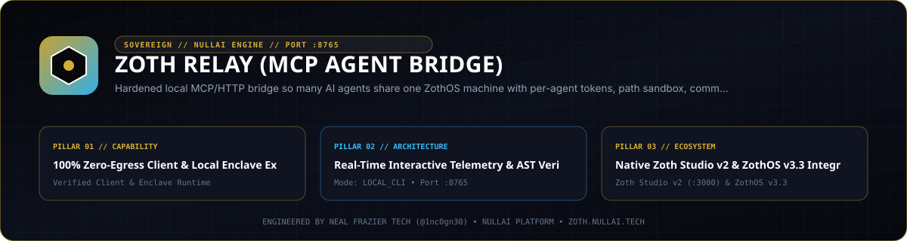

<div align="center">
  
</div>

<br />

# zoth-relay

A secure local bridge that lets **many AI agents** work on one ZOTHOS (Debian trixie / KDE) or Parrot OS machine, each with its own token, scope and audit trail. Supported clients include Meta Muse Code, Grok Bot, ChatGPT custom GPTs, Claude, Cursor and anything else that speaks MCP or HTTP.

```
 Muse Code ─┐  MCP (HTTP /mcp or stdio)
 Claude/Cursor ┤
 Grok Bot ──┤  REST /v1 (+ NDJSON stream)     cloudflared ──►  127.0.0.1:8765  zoth-relay (user zoth-relay, systemd-hardened)
 ChatGPT GPT ┤  GPT Actions (/openapi-actions.json)                    │
 dots, jev… ┘                                                     per-agent dirs, profile, rate limit, audit
```

zoth-relay evolved from `parrot-relay` and keeps everything it had: non-root service user, path sandbox, command blocklist, rate limits, JSON audit log, systemd hardening, cloudflared quick tunnel, and install/uninstall scripts.

## Install
```bash
sudo ./install.sh --with-cloudflared         # detects ZOTHOS / Parrot / Debian
sudo zoth-relay agent add muse --profile dev  # token printed ONCE
cloudflared tunnel --url http://localhost:8765
```
The first install creates a `local-admin` agent (read-only, `dashboard: true`) and prints its token. The **Zoth Relay** launcher in the KDE menu opens the read-only dashboard at `http://127.0.0.1:8765/dashboard`.

## Agents
```bash
sudo zoth-relay agent add NAME [--profile read-only|workspace|exec|dev] [--dir D]... [--allow-cmd PROG]... [--rate N] [--dashboard]
sudo zoth-relay agent list | revoke NAME | rotate NAME | remove NAME
```
| profile | status | list_dir / read_file | write_file | run_command |
|---|---|---|---|---|
| read-only | ✓ | ✓ | | |
| workspace | ✓ | ✓ | ✓ | |
| exec | ✓ | ✓ | ✓ | ✓ |
| dev | ✓ | ✓ | ✓ | ✓ (Landlock-sandboxed to one workspace, binds 127.0.0.1:4100-4199 only; see docs/muse-code.md) |
| mobile | ✓ | | | (only `POST /v1/ask` to configured AI targets; see MOBILE.md) |

`/etc/zoth-relay/agents.yaml` stores only the SHA-256 of each token. The service hot-reloads it, so `revoke` and `rotate` take effect on the next request. By default each agent gets `~/agent-workspace/<name>`, so agents can't see each other's files unless you give them a shared `--dir`.

## Interfaces
| | endpoint |
|---|---|
| REST | `/status /file /dir /exec /exec/run`, also under `/v1/...` |
| NDJSON stream | `POST /v1/exec` |
| MCP (streamable HTTP) | `POST /mcp`, tools `status list_dir read_file write_file run_command` |
| MCP (stdio) | `ZOTH_RELAY_TOKEN=… zoth-relay mcp-stdio`, a bridge to the running service |
| GPT Actions | `GET /openapi-actions.json` (OpenAPI 3.1, bearer, non-streaming) |
| Dashboard | `GET /dashboard`, loopback only + token with `dashboard: true` |
| Mobile ask | `GET /v1/agents`, `POST /v1/ask` (text + image, NDJSON stream), `POST /v1/live/token` (Gemini Live ephemeral token), `mobile` profile only. See [MOBILE.md](MOBILE.md) |
| Health | `GET /health` (alias of `/healthz`, public) |

Connection guides: [Grok Bot](docs/grok-bot.md) · [ChatGPT GPT Actions](docs/chatgpt-gpt-actions.md) · [Claude & Cursor](docs/claude-cursor-mcp.md) · [Muse Code](docs/muse-code.md) · [generic agents (dots, jev, …)](docs/generic-agent.md)

## Security model
Layers, from strongest to weakest:
1. **OS sandbox (the real protection).** The service runs as the `zoth-relay` system user: nologin, removed from sudo/adm/docker/disk, and its code is root-owned. systemd applies `NoNewPrivileges`, an empty capability set, `ProtectSystem=strict`, `ProtectHome=tmpfs` (other users' homes are invisible), `PrivateDevices`, `PrivateTmp`, kernel/cgroup protections, `RestrictNamespaces`, `MemoryMax=2G` and `TasksMax=256`.
2. **Per-agent tokens.** Each token is 288-bit random, and only its hash is stored. A token is never logged. Each agent has its own rate limit.
3. **Path scoping.** Every path is fully resolved, symlinks included, and must sit inside *that agent's* `allowed_dirs`. The same check applies to the exec working directory.
4. **Profiles and optional per-agent command allowlist.**
5. **Command blocklist.** Refuses `rm -rf /`, mkfs, dd to disks, sudo, shutdown, fork bombs and similar.
6. **Audit log.** `/var/log/zoth-relay/audit.log` records every request in JSON, tagged with `agent`, `via` (rest/mcp) and the IP (CF-Connecting-IP).

### Threat caveats (read these)
- **The blocklist and `--allow-cmd` can be bypassed.** They inspect a bash string, and bash is Turing-complete: `python3 -c`, `perl`, `eval "$(printf …)"`, scripts written to disk and then run, and so on. They exist to catch accidents and lazy prompt injection. They don't stop a determined attacker. **Any `exec` agent can do anything the `zoth-relay` user can do.** That includes reading every agent's directories, because they all live under one Unix user. Path scoping between agents is enforced only for the file APIs and the exec cwd, *not* inside a command. If agents must be truly isolated from each other, don't give the untrusted one `exec`; use the **`dev`** profile instead, which wraps every command in a Landlock kernel sandbox (own workspace read/write only, system dirs read-only, TCP bind limited to `dev_ports`), or run a second instance under a different user.
- Exec agents have network access (needed for git/pip). Anyone holding a token can use the box as a network pivot.
- A token is a password. Anyone who has it, including a prompt-injected agent, gets that agent's powers. Prefer `read-only` or `workspace`, and rotate tokens often.
- Quick tunnels publish an unauthenticated URL. The bearer token is the only gate, and `/openapi-actions.json` and `/healthz` are public (they contain no data). The dashboard refuses any request that carries Cloudflare headers.
- The MCP DNS-rebinding check is off unless you set `mcp_allowed_hosts`. The bearer token still applies.
- `mcp-stdio --direct` runs as *your* user and skips the systemd sandbox. It's for development only.
- Audit logs contain full command lines, so don't put secrets in commands.

## Development
```bash
python3 -m venv .venv && .venv/bin/pip install -r requirements-dev.txt
.venv/bin/python -m pytest -q     # unit tests
./scripts/smoke.sh                # real server on 127.0.0.1:18765
gitleaks detect --source . -v     # secret scan
```

MIT licensed. Not affiliated with Meta, xAI, OpenAI, Anthropic or Cursor.
