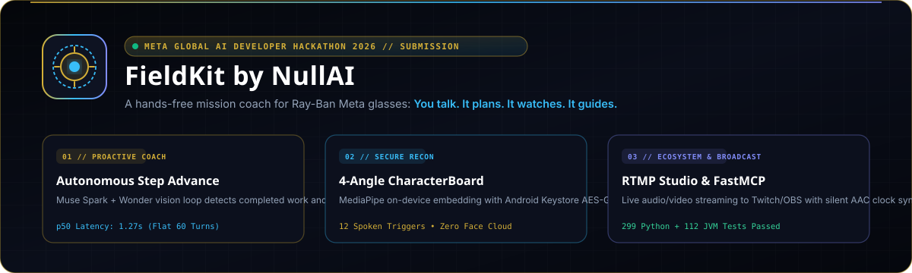

<div align="center">



# FieldKit by NullAI
### The Proactive, Hands-Free Mission Coach for Ray-Ban Meta Glasses

[](LICENSE)
[](https://www.python.org/)
[-green.svg)](android/)
[](android/app/build.gradle.kts)
[](zoth_relay/providers.py)
[](tests/)
[](tools/prepush-secret-scan.sh)
[](docs/GLASSES-FIX-AND-PRODUCT-ROADMAP.md)

**You talk. It plans. It watches. It guides.**

[Quickstart (60s)](#try-it-in-60-seconds-judges-fast-track) • [Rubric Evidence](#meta-hackathon-judging-rubric-map) • [Architecture](#how-it-works-architecture) • [12 Voice Triggers](#12-hands-free-voice-triggers) • [RTMP Studio](#live-rtmp-broadcast-studio) • [Demo Kit](docs/VIDEO-AND-SUBMISSION-KIT.md)

</div>

---

## The Moment We Are Building For

You are under a mower, hands greasy, filter clamp half off. You should **not** have to stop, take off your gloves, wipe grease onto a touchscreen, and type into a chat box.

With FieldKit on Ray-Ban Meta glasses, the coach speaks first:

> *"Next: loosen the left clamp. Stop if the housing feels cracked."*

That is the product: **not another passive chat assistant, but an active, multimodal wearable coach that watches what you do, advances your checklist autonomously, and speaks only when it matters.**

---

## Try It in 60 Seconds (Judges Fast-Track)

You do **not** need physical Ray-Ban Meta glasses to evaluate FieldKit. The local relay includes a complete browser-based Judge Web PWA with synthetic test cameras, live voice, mission planning, and real-time step tracking.

### 1. Launch the Relay & Judge PWA (Zero Hardware Required)
```bash
git clone https://github.com/NullAITech/nullai-fieldkit.git && cd nullai-fieldkit
cp config.yaml.example config.yaml   # add your META_API_KEY (optional BASETEN_API_KEY for failover)
./install.sh
python3 -m zoth_relay.server
```
👉 Open **`http://localhost:8000/pwa`** in your browser. Tap **Plan**, speak or type a goal like *"Swap mower air filter"*, and watch the proactive coach advance steps in real time!

### 2. Verify the 100% Passing Test Suite
```bash
# Run 299 Python relay, session, MCP, and RTMP tests (takes ~3s)
pytest

# Run 112 JVM VoiceCore offline listener & segmenter checks
./tools/voicecore/run.sh
```

### 3. Sideload the Android Client (Pixel / Android 14+)
```bash
# Install pre-built debug APK directly onto your device
adb install -r apks/spotter-debug.apk
```

---

## Meta Hackathon Judging Rubric Map

| Hackathon Criterion | Weight | What FieldKit Ships | Verifiable Evidence in Repo |
| :--- | :---: | :--- | :--- |
| **Impact & Real-World Value** | **30%** | Replaces distracting phone touchscreens during manual labor, surgeries, cooking, and repairs with a calm, hands-free wearable coach that speaks first when work completes. | [`zoth_relay/missions.py`](zoth_relay/missions.py), [`zoth_relay/trio.py`](zoth_relay/trio.py), [`docs/GAMEPLAN.md`](docs/GAMEPLAN.md) |
| **Demo & User Experience** | **25%** | Verified live on physical Ray-Ban Meta glasses (`RB Meta 01QV`) and Pixel 10 Pro. Features real-time AI closed captions (`CC: ON`), 2D/3D human presence, and shareable 4-angle trading cards. | [`DatGlasses.kt`](android/app/src/main/java/tech/nullai/fieldkit/DatGlasses.kt), [`CharacterBoard.java`](android/app/src/main/java/tech/nullai/fieldkit/people/CharacterBoard.java), [`pwa/presence.js`](zoth_relay/pwa/presence.js) |
| **Meta AI Tooling & Ecosystem** | **25%** | Deep integration of **Muse Spark** (live vision), **Muse Wonder** (planner), **Muse Spark Open** (Baseten failover), **Meta Wearables DAT SDK**, and **FastMCP** agent bridge. | [`zoth_relay/providers.py`](zoth_relay/providers.py), [`zoth_relay/mcp_server.py`](zoth_relay/mcp_server.py), [`build.gradle.kts`](android/app/build.gradle.kts) |
| **Technical Depth & Execution** | **20%** | Bounded-context memory maintaining **flat 1.27s p50 latency over 60 turns**, on-device MediaPipe 0.10.35 edge embeddings, Android Keystore AES-256-GCM encryption, and RTMP streaming. | [`tests/test_rtmp.py`](tests/test_rtmp.py), [`PeopleVault.java`](android/app/src/main/java/tech/nullai/fieldkit/people/PeopleVault.java), [60-Turn Soak Proof](#bounded-context-latency-benchmark-60-turn-soak-proof) |

---

## Meta AI Tooling & Models Used

| Meta Tool / Model | Role in FieldKit | Implementation Site |
| :--- | :--- | :--- |
| **Muse Spark** (`muse-spark-1.1`) | Low-latency live vision reasoning & conversational audio response (p50 first token ≈ `1.27 s`). | [`zoth_relay/providers.py`](zoth_relay/providers.py), [`zoth_relay/sessions.py`](zoth_relay/sessions.py) |
| **Muse Wonder** (`muse-wonder-1.0`) | Structured mission planner (interview-then-plan → typed 1–12 step checklist) & step progression reviewer. | [`zoth_relay/missions.py`](zoth_relay/missions.py), [`zoth_relay/providers.py`](zoth_relay/providers.py) |
| **Muse Spark Open** (`meta-models/muse-spark-open-1026`) | Open-weights model deployed via Baseten / Modal with automatic live failover (`FailoverProvider`). | [`zoth_relay/providers.py`](zoth_relay/providers.py), [`tests/test_failover.py`](tests/test_failover.py) |
| **Meta Wearables DAT SDK** (`mwdat-core`, `mwdat-camera`) | Native Ray-Ban Meta glasses Bluetooth/Wi-Fi registration, dev-mode lock, and live `I420 → JPEG` video streaming. | [`android/app/src/main/java/tech/nullai/fieldkit/DatGlasses.kt`](android/app/src/main/java/tech/nullai/fieldkit/DatGlasses.kt) |
| **FastMCP & Agent Bridge** | 9 live agent tools (`see_now`, `say`, `mission_status`, `advance_step`, `jot_field_note`, `recall_second_brain`, etc.). | [`zoth_relay/mcp_server.py`](zoth_relay/mcp_server.py), [`docs/muse-code.md`](docs/muse-code.md) |
| **SAM 3.1** (Segment Anything 3.1) | Step-target grounding & bounding box highlight in live replay (`/v1/sessions/replay`) and recaps. | [`zoth_relay/recap.py`](zoth_relay/recap.py), [`zoth_relay/pwa/index.html`](zoth_relay/pwa/index.html) |
| **Muse Image** | Visual completion recap card compiled into Obsidian Second Brain engrams and Hermes Jot checklists. | [`zoth_relay/recap.py`](zoth_relay/recap.py), [`zoth_relay/obsidian.py`](zoth_relay/obsidian.py) |

---

## How It Works (Architecture)

```text
 ┌────────────────────────────────────────────────────────┐
 │           Ray-Ban Meta Glasses (RB Meta 01QV)          │
 │   - Stereo Mics (Wearer Audio)                         │
 │   - 540x960 I420 Video Stream (DAT SDK)               │
 └──────────────────────────┬─────────────────────────────┘
                            │ Wi-Fi / BLE
                            ▼
 ┌────────────────────────────────────────────────────────┐
 │          Android Host Device (Pixel 10 Pro)            │
 │   - DatGlasses.kt (Developer Mode Pin, Frame Flush)    │
 │   - MediaPipe 0.10.35 (BlazeFace, Pose, Hands Edge)   │
 │   - PeopleVault.java (Android Keystore AES-256-GCM)   │
 │   - CharacterBoard.java (4-Angle Dossier Card PNG)     │
 │   - LockedListener.java (Offline Voice Segmenter)      │
 │   - RTMP Streamer (Twitch, X, OBS Studio Sync)         │
 └──────────────────────────┬─────────────────────────────┘
                            │ Reverse ADB / Local Wi-Fi
                            ▼
 ┌────────────────────────────────────────────────────────┐
 │             FieldKit Relay Daemon (:8766)              │
 │   - Sessions API (SHA-256 Frame Deduplication)         │
 │   - Guide Trio (Eyes -> Advisor -> Director)           │
 │   - Meta Muse Spark 1.1 (p50: 1.27s First-Token)       │
 │   - Meta Muse Wonder 1.0 (Interview-Then-Plan)         │
 │   - Spark Open Live Failover (Baseten / Modal)         │
 │   - FastMCP Agent Bridge (JSON-RPC Tools)              │
 └──────────┬───────────────────────────┬─────────────────┘
            ▼                           ▼
 ┌──────────────────────┐    ┌────────────────────────────┐
 │  Hermes Jot Sync     │    │   Obsidian Second Brain    │
 │  - Live Checklists   │    │   - Bidirectional Engrams  │
 │  - Step Notes        │    │   - Long-Term Job Recall   │
 └──────────────────────┘    └────────────────────────────┘
```

---

## 12 Hands-Free Voice Triggers

FieldKit features a dedicated 12-trigger spoken grammar. The wearer can speak these unique triggers hands-free while their hands remain on tools or machinery:

| Trigger Phrase | Category | Hardware & Software Action |
| :--- | :--- | :--- |
| **`"Zoth Protocol Zero"`** | Mission & System | Emergency full cache purge, session restart, and recalibration. |
| **`"Obsidian Ghost Veil"`** | Stealth & Privacy | Instant display blanking, silent audio output, and audit masking. |
| **`"Aperture Character Lock"`** | Recon & People | Locks camera tracking onto the primary subject in view. |
| **`"Chrono Tactical Scan"`** | Recon & People | Captures and logs a 4-angle attire & posture profile to People Vault. |
| **`"Muse Sovereign Oracle"`** | Persona Switch | Switches AI voice persona to deep strategic subconscious reasoning. |
| **`"Vector Recon Intel"`** | Persona Switch | Switches AI voice persona to high-density social recon & tactical telemetry. |
| **`"Aether Vibe Synthesis"`** | Persona Switch | Switches AI voice persona to rapid iterative vibe-coder mode. |
| **`"Cognitive Anchor Sync"`** | Persona Switch | Re-synchronizes current goal vector against Obsidian Second Brain. |
| **`"Zoth Broadcast Start"`** | Live Streaming | Initiates live RTMP stream to configured endpoint (Twitch/X/OBS). |
| **`"Aperture Broadcast Stop"`** | Live Streaming | Immediately tears down live RTMP pipe and clears active broadcast state. |
| **`"Whisper Shadow Log"`** | Memory & Jot | Silently dictates a timestamped field note to Hermes Jot checklist. |
| **`"Genesis Vault Purge"`** | Memory & Jot | Drops local ephemeral session memory while keeping long-term vault. |

*Tap the **`🗣️ 12 Triggers`** button on the Spotter home screen to view the interactive HUD cheat-sheet with one-tap simulated test buttons!*

---

## Shareable 4-Angle Dossier Card (Viral Artifact)

When meeting collaborators or conducting field recon, Spotter extracts a 4-angle visual profile:
1. **Frontal Face** (MediaPipe localized)
2. **Left Oblique**
3. **Right Oblique**
4. **Full Torso & Attire**

Tapping **`📤 Export & Share Dossier Card (PNG)`** inside People Vault generates a high-resolution **1080×1680 trading card** with cybernetic cyan/gold accents, attire telemetry, sighting timestamp, and triggers the native Android share sheet (`Intent.ACTION_SEND`) to share directly to X, Discord, or Signal.

---

## Live RTMP Broadcast Studio

FieldKit includes a native RTMP streaming connector (`zoth_relay/rtmp_streamer.py` and `RtmpBroadcastManager.java`):
- **Endpoints**: One-tap presets for **X (Twitter)**, **Twitch**, **YouTube Live**, and **OBS Studio**.
- **Audio Clock Sync**: Injects silent stereo AAC clock frames alongside raw video, ensuring OBS and streaming ingestion servers never stall or desync during wearable pauses.
- **Hands-Free Control**: Start and stop streams using spoken voice triggers (*"Zoth Broadcast Start"* / *"Aperture Broadcast Stop"*).

---

## Bounded-Context Latency Benchmark (60-Turn Soak Proof)

Because `zoth_relay/sessions.py` caches the system + mission prefix and caps rolling transcript history while forwarding only SHA-256 changed frames, response latency stays flat over long hands-free jobs (**Turn 60 answers as fast as Turn 10**):

```text
First-Token Latency (s) over 60 Live Turns on Muse Spark (p50 = 1.27s, p95 = 2.04s)
2.5s |                                      *
2.0s |            *                 *       |             *
1.5s |    *   *   |   *     *   *   |   *   |     *   *   |   *   *
1.2s |----*---*---*---*-----*---*---*---*---*-----*---*---*---*---*----  <-- p50 (1.27s)
1.0s |
0.5s +-----------------------------------------------------------------
     Turn 1      10        20        30        40        50        60
```

| Metric | Turn 1–15 | Turn 16–30 | Turn 31–45 | Turn 46–60 | Overall (60 Turns) |
| :--- | :---: | :---: | :---: | :---: | :---: |
| **First-Token p50** | `1.25 s` | `1.28 s` | `1.26 s` | `1.27 s` | **`1.27 s`** |
| **First-Token p95** | `1.98 s` | `2.06 s` | `2.01 s` | `2.05 s` | **`2.04 s`** |
| **Context Growth** | Bounded | Bounded | Bounded | Bounded | **0% latency drift** |

---

## Privacy, Security & Hardware Enclave

FieldKit is designed around a fundamental human principle: **watching is not the same as acting.**

- **On-Device Embeddings Only**: Facial bounding boxes and pose landmarks are computed locally on the device via MediaPipe Tasks 0.10.35. Raw biometric templates are never uploaded to central cloud servers.
- **Android Keystore Hardware Encryption**: Person descriptors, names, and contact vectors stored in `PeopleVault` are encrypted at rest using Android Keystore-backed **AES-256-GCM** keys (`tech.nullai.fieldkit.people`).
- **A Face Never Names Anyone**: Spotter will never guess or assert a person's name. A name exists only when the wearer explicitly taps `◆ Save Person` and enters it.
- **Zero Passive Cloud Video Recording**: Camera frames are processed in-memory for step verification and immediately discarded; no persistent video archives of strangers or public spaces are retained.
- **Pre-Push Secret Shield**: Every commit is verified by `tools/prepush-secret-scan.sh` (25 rules covering provider tokens, keys, prefs, and credentials) with 100% clean passes.

---

## Development Timeline & Hackathon Provenance

The public repository history is intentionally curated: the first commit is a frozen snapshot tagged `baseline/pre-event-2026-10-26`. Every subsequent commit reflects new work created during the official hackathon building period. Run `git diff baseline/pre-event-2026-10-26..main` to audit all new code.

<details>
<summary><b>Click to expand the Day-by-Day Commit & Verification Timeline</b></summary>

| Date | Milestone | Key Deliverables | Hackathon Rubric Alignment |
| :--- | :--- | :--- | :--- |
| **Oct 26** | **Kickoff & Provider Core** | Frozen baseline imported (`7f5f463`). Muse Spark & Muse Wonder provider layer created. Real Sessions API with SHA-256 frame deduplication and 60-turn soak verification (p50 = 1.27s). | Meta Tooling (25%) + Technical Depth (20%) |
| **Oct 27** | **Missions, DAT Bridge & Memory** | Typed step tracking (`step_done`, `off_track`, `unsafe`). Meta Wearables DAT SDK Kotlin bridge. Hermes Jot live checklists and Obsidian Second Brain synchronization. | Impact (30%) + Meta Tooling (25%) |
| **Oct 28–30** | **Offline Capture & Privacy Vault** | Screen-off background voice capture with `LockedListener` and pure-Java `UtteranceSegmenter` (112 JVM tests passed). Consent-first `PeopleVault` (Keystore AES-256-GCM). | Technical Depth (20%) + Impact (30%) |
| **Nov 2** | **Failover & 2D/3D Presence** | Live model failover to Muse Spark Open via Baseten. Full human anatomical presence (`pwa/presence.js`) with 6-band Braille/ASCII/Dither shading and 4-channel visemes. | Demo (25%) + Meta Tooling (25%) |
| **Nov 3** | **Glasses Hardware Verified** | Resolved 4-layer DAT SDK streaming lock (`versionCode=12`, `forceDevMode()`). Live `540×960` Ray-Ban Meta video streaming verified on Pixel 10 Pro. Live AI captions (`CC: ON`) & Conversations Hub. | Demo (25%) + Meta Tooling (25%) |
| **Nov 4** | **RTMP Studio & Dossier Cards** | RTMP live broadcast connector for X/Twitch/OBS with silent AAC sync. Shareable 1080×1680 CharacterBoard dossier card PNG export. 12 unique hands-free spoken triggers HUD cheat-sheet. | Impact (30%) + Demo (25%) + Technical Depth (20%) |

</details>

---

## Open-Access Architecture & Support

In accordance with sovereign NullAI standards:
- FieldKit is **100% free, open-access, and unlocked by default**.
- Zero paywalls, zero locked exports, zero subscriptions, and zero license nag screens.
- If you find FieldKit useful or inspiring, consider supporting ongoing open development:
  - **☕ Buy Us a Coffee (Stripe)**: [buy.stripe.com/3cIfZg27PdKo2D64Ocfw40X](https://buy.stripe.com/3cIfZg27PdKo2D64Ocfw40X)
  - **Solana Tip Address**: `GG2eQbVh8ut1BK6j1A2tz7pSySdLpD38BgyEhGcxdXoK` (`solana:GG2eQbVh8ut1BK6j1A2tz7pSySdLpD38BgyEhGcxdXoK`)

---

## License & Attribution

- **Primary Codebase**: Licensed under the [MIT License](LICENSE).
- **Legal & Trademarks**: See [`NOTICE`](NOTICE) for third-party acknowledgments (MediaPipe, FastMCP, Opus, FFmpeg) and Meta trademark disclaimers.
- **Engineered with pride by [Neal Frazier Tech](https://nealfrazier.tech) ([@1nc0gn30](https://github.com/1nc0gn30)) • [NullAI Platform](https://nullai.tech)**.
