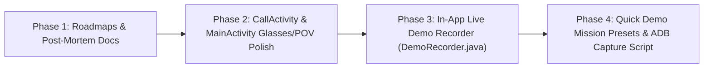

# ZOTH FIELDKIT (Spotter) — Meta Ray-Ban Glasses Fix & Product Enhancement Roadmap

**Updated**: 2026-11-03  
**Target Device**: Google Pixel 10 Pro (`59230DLCH003XU`) + Ray-Ban Meta Smart Glasses (`RB Meta 01QV`, MAC `7A:03:48:F8:52:83`, Firmware `129.0.1.23.378`)  
**App Package**: `tech.nullai.fieldkit` (`versionCode = 12`, `versionName = "0.3.3"`)  
**Meta Wearables DAT SDK**: `com.meta.wearable:mwdat-core:1.0.1`, `mwdat-camera:1.0.1`

---

## Part 1 — Root-Cause Post-Mortem: Why the Meta Glasses Were Not Streaming & How We Fixed It

When clearing app cache/storage on `tech.nullai.fieldkit` and re-pairing with the Meta AI app (`com.facebook.stella`), the Ray-Ban Meta glasses (`RB Meta 01QV`) discovered over Bluetooth (`devices=1`, `reg=REGISTERED`) but failed to stream video into Spotter. Decompiling `mwdat-core-1.0.1-runtime.jar` and tracing live `adb logcat` exposed **5 concrete root causes**:

### 1. `Wearables.startRegistration()` Clobbered `isDevMode = false` in Memory (`Activity` vs `ComponentActivity`)
- **What Happened**:
  - Spotter uses `<meta-data android:name="com.meta.wearable.mwdat.APPLICATION_ID" android:value="0" />` (Developer Mode app).
  - In `com.meta.wearable.dat.core.internal.registration.RegistrationManagerImpl.askRegistration(Activity, boolean)`, bytecode offset `17–19` unconditionally executes `this.devMode = false` in memory before launching Meta AI (`com.facebook.stella`).
  - `RegistrationManagerImpl.launchIntentForResult()` checks `if (activity instanceof androidx.activity.ComponentActivity)`. Because `MainActivity` and `CallActivity` extend `android.app.Activity`, the SDK falls back to `activity.startActivityForResult(intent, 0)` and **drops the `ActivityResultCallback`**.
  - Consequently, after approving Spotter in Meta AI, `Wearables.isDevMode` remained `false` in memory (`Starting DeviceSession (devMode=false)`), causing the glasses to reject the session.
- **How We Fixed It**:
  - Implemented `DatGlasses.forceDevMode(context)` in `DatGlasses.kt`, which both persists `is_dev_mode = true` in `dat_registration` `SharedPreferences` and uses reflection on `Wearables.instance.registrationManager.devMode` to restore `true` in memory immediately after `initialize()`, `startRegistration()`, `handleIntent()`, `onActivityResult(requestCode = 0)`, and prior to every `Wearables.createSession()` / `session.start()`.

### 2. Glasses Camera Permission (`Permission.CAMERA`) Checked Before Bluetooth ACDC Link Settled
- **What Happened**:
  - `MainActivity.startGlassesFlow()` called `DatGlasses.checkCameraPermission(...)` ~15ms after startup while the ACDC Bluetooth L2CAP link (`[ACDC]MetaWearable-7A:03:48:F8:52:83`) was still `CONNECTING` (~600ms handshake).
  - Because `LinkState.CONNECTED` was not yet reached, `Wearables.checkPermissionStatus(Permission.CAMERA)` returned `null` (`NO_DEVICE: All discovered devices are powered off or disconnected`).
  - `startGlassesFlow()` treated `status == null` as allowed and invoked `DatGlasses.connect()`, which never checked `Permission.CAMERA` after `LinkState.CONNECTED` was established. After clearing app storage, Meta AI's per-app camera permission was ungranted, causing `session.start()` / `addCamera()` to fail silently.
- **How We Fixed It**:
  - Inside `DatGlasses.connect()`, once `LinkState.CONNECTED` and `DeviceCompatibility.COMPATIBLE` settle, Spotter now queries `Wearables.checkPermissionStatus(Permission.CAMERA)` over the active `com.facebook.wearable.system.permissions` DataX channel.
  - If `PermissionStatus.Denied` is returned, `DatGlasses.connect()` automatically launches `createCameraPermissionIntent(act)` (`REQ_DAT_CAM = 4101`) so Meta AI prompts the wearer to grant glasses camera permission, and resumes streaming immediately upon approval.

### 3. `START_ERROR_DEVICE_UNAVAILABLE` Race & Hardware Wear/Hinge Gating (`DeviceStateChannel 7009`)
- **What Happened**:
  - Immediately after `LinkState.CONNECTED`, `DeviceStateChannel` (`service 7009`) takes several hundred milliseconds to report `DeviceCompatibility.COMPATIBLE`, `HingeState.OPEN`, and `DonState.DONNED`.
  - Furthermore, Ray-Ban Meta firmware (`coreux`) refuses camera sessions with `START_ERROR_DEVICE_UNAVAILABLE` (`No eligible device available`) if the glasses' arms are folded (`HingeState.CLOSED`), the nose-bridge capacitive sensor detects they are not worn (`DonState.DOFFED`), or the glasses entered Bluetooth standby (`HCI reason=19`).
  - Previously, `DatGlasses.connect()` tried `sess.start()` once and aborted after 120ms.
- **How We Fixed It**:
  - Added a post-link settle wait (up to 1.2s) for `DeviceCompatibility.COMPATIBLE` and `HingeState != UNKNOWN`.
  - Added a 6-attempt session startup retry loop in `DatGlasses.connect()` with real-time hardware state diagnostics (`[RB Meta 01QV link=... compat=... don=... hinge=... batt=...%]`) surfaced directly in the UI status bar.
  - Added a background `deviceWatcherJob` in `DatGlasses.init()` that monitors `Wearables.devicesMetadata` and **auto-connects** the instant the wearer unfolds and puts on the glasses.

### 4. `CallActivity` Missing `DatGlasses` Activity Context, Permission Result Hook & Live POV Preview
- **What Happened**:
  - When switching from `MainActivity` to `CallActivity`, `MainActivity.onPause()` detached `currentActivity`, and `CallActivity` never called `DatGlasses.INSTANCE.attachActivity(this)` or handled `onActivityResult`.
  - In `CallActivity`, switching camera source to `Glasses` while `Eyes off` left `videoOn = false`, causing `onEyesFrame()` to drop all glasses frames (`if (!videoOn) return;`).
  - In `CallActivity`, `ivEyesPreview` remained `View.GONE` unless `Detect on` was also toggled, hiding the live glasses POV stream during normal Muse calls.
  - `callEyes.onStatus()` checked `if (!started)`, which was always false because `started = true` was set two lines before registering the listener.
- **How We Fixed It**:
  - Wired `DatGlasses.INSTANCE.attachActivity(this)` / `detachActivity(this)` and `onActivityResult` (`REQ_DAT_CAM = 4101` and `requestCode = 0`) into `CallActivity`.
  - Released `MainActivity`'s phone camera and `SoundField` mic cleanly before launching `CallActivity`.
  - Made `switchSource(true)` automatically enable `Eyes on` (`setEyes(true)`), and made `ivEyesPreview` render the live POV stream whenever `videoOn` is active (with 1-tap PIP ↔ Expanded POV toggle).

### 5. `WindowManager$BadTokenException` Crash on First-Run `onDestroy()`
- **What Happened**:
  - After clearing app storage (`goal_mode_asked == false`), `MainActivity.onDestroy()` called `disconnect()`, which posted `ModePicker.show(this)` onto a destroyed window token.
- **How We Fixed It**:
  - Guarded `disconnect()` and `showModePicker()` with `!isFinishing() && !isDestroyed()`.

---

## Part 2 — Product & Feature Enhancement Roadmap

With the Ray-Ban Meta DAT connection and video streaming pipeline hardened, we are executing the following product enhancements in order:

### Phase 1 — Documentation & Architecture Baseline (Completed)
- Record full root-cause post-mortem and product roadmap in `docs/GLASSES-FIX-AND-PRODUCT-ROADMAP.md` and `ROADMAP-FOR-MUSE.md`.
- Maintain `versionCode = 12` across all debug builds so Meta AI developer registration remains persistent across installs.

### Phase 2 — `CallActivity` & `MainActivity` Seamless Glasses Handoff & Live POV HUD
- **Live POV Preview in `CallActivity`**:
  - Show `ivEyesPreview` automatically whenever `Eyes on` (`videoOn == true`) is active—streaming smooth live frames from Ray-Ban Meta glasses or phone camera even when `Detect` is off, and overlaying bounding boxes when `Detect` is on.
  - Add **1-tap PIP ↔ Expanded Stage toggle** on `ivEyesPreview` so the wearer can enlarge the first-person glasses view during a live Muse call.
- **Clean Hardware Handoff (`MainActivity` ↔ `CallActivity`)**:
  - Stop `SoundField` and close the phone camera in `MainActivity.startCall()` before starting `CallActivity`.
  - Automatically pass `EXTRA_ON_GLASSES = true` and `EXTRA_EYES = true` when launching a call from `Meta glasses` mode or while glasses are actively streaming.
  - Attach `DatGlasses` activity lifecycle (`attachActivity`, `detachActivity`, `onActivityResult`) inside `CallActivity`.

### Phase 3 — Built-In Live Demo Recorder (`DemoRecorder.java`)
To let the wearer record a complete, broadcast-ready hackathon demo **while actively using Spotter** (without Android `MediaProjection` permission popups or external screen recorders):
- **Hardware MP4 Video Encoder (`MediaCodec` H.264 + `MediaMuxer`)**:
  - Encodes a `720x1280` (portrait HD, 24fps, 4 Mbps H.264) `.mp4` video directly inside the app.
- **Cinema HUD Compositor**:
  - Composites onto every frame:
    1. **Live POV Video Feed**: Latest Ray-Ban Meta glasses frame (`DatGlasses`) or phone camera frame (`ImageReader` / `CamFeed`), letterboxed/fitted cleanly with subtle frame border.
    2. **Top Telemetry Header**: `ZOTH FIELDKIT · SPOTTER` brand header, active source badge (`[RAY-BAN META 01QV · LIVE]` or `[PHONE CAMERA · LIVE]`), FPS & stream telemetry (`tvStream` / `CallStats`), and pulsing red recording timer (`● REC 00:42 / 03:00`).
    3. **Mission Step & Coach Card**: Current Mission Step (`Step 1/4: ...`) or Muse Call state (`Muse live — voice and eyes`).
    4. **Live Subtitles / Transcript Overlay**: Spoken coach utterances (`Muse: ...`), wearer speech (`You: ...`), and on-device vision detections (`in view: ...`).
- **Instant Gallery Export + Share Sheet + Companion Cue Sheet**:
  - Writes finished recordings to `Movies/SpotterDemos/spotter-demo-YYYYMMDD-HHMMSS.mp4` via Android `MediaStore` (immediately visible in Google Photos / Gallery and `/sdcard/Movies/SpotterDemos/`).
  - Generates a timestamped markdown cue sheet (`spotter-demo-YYYYMMDD-HHMMSS.md`) logging every mission step, voice turn, and glasses state transition for instant X/hackathon captioning.
  - Provides a **`● REC Demo`** button right on the `MainActivity` and `CallActivity` HUDs, plus a post-recording dialog to **Play Video** or **Share MP4** with one tap.

### Phase 4 — 1-Tap Demo Mission Presets & Desktop ADB Capture CLI
- **1-Tap Demo Goal Chips in `MainActivity`**:
  - Tap the `Goal` label or options menu to pick from curated 3-minute hackathon demo missions (e.g., *"Inspect workbench & tighten clamp"*, *"Replace air filter & verify orientation"*, *"Check server rack cabling & label ports"*, *"Make pour-over coffee step by step"*).
- **Desktop Companion Script (`scripts/record-live-demo.sh`)**:
  - CLI utility to start/stop or pull the latest recorded demo MP4 and markdown cue sheet from the connected Pixel 10 Pro (`adb pull /sdcard/Movies/SpotterDemos/ ...`).

---

## 4. Phase 4: Live AI Captions, Conversation History & 4-Angle Face + Body Character Boards

### A. Live AI Model / Agent Closed Captions (`CC: ON/OFF`)
- **Relay Output Transcription (`zoth_relay/live.py`)**:
  - Enabled `"outputAudioTranscription": {}` and `"inputAudioTranscription": {}` in the Gemini Live setup payload so native audio model responses stream synchronized text transcriptions alongside 24 kHz PCM audio.
- **Client Streaming Parser (`LiveCall.java`)**:
  - Added `outputTranscription` chunk accumulation in `LiveCall.handleFrame` so spoken AI sentences stream live to the UI without waiting for turn completion.
- **Toggleable HUD Subtitle Banner (`MainActivity` & `CallActivity`)**:
  - Added a `CC: ON / CC: OFF` toggle button in the top bar of both the Spotter Home HUD (`btnMainCaptions`) and the Muse Live Call screen (`btnCallCaptions`), backed by `ConversationStore` preferences and `tvLiveCaptions` / `tvMainLiveCaptions` subtitle overlays.

### B. Conversations Manager (`ConversationsActivity` & `ConversationStore`)
- **Persistent Multi-Thread Store (`ConversationStore.java`)**:
  - Stores conversation threads (`conversations_v1.json`) with turn-by-turn speaker attribution (`Muse`, `Coach`, `You`, `Vision`) and timestamps.
- **Interactive Conversations View (`ConversationsActivity.java`)**:
  - Accessible via the **`💬 Chats`** button on both `MainActivity` and `CallActivity`.
  - Allows browsing past/active conversations, reading/copying/sharing full transcripts, toggling `CC: ON/OFF`, and starting a brand-new **Mission Chat** (`+ New Chat`) or **Muse Live Call** (`+ New Muse Call`).

### C. Dual Face + Body Recognition & 4-Angle Character Board System
- **On-Device Face + Body Detection (`Detector.java` & `PersonDescriptor.java`)**:
  - Enabled full-body `"person"` bounding box extraction from `EfficientDet-Lite0` (`Detector.Result.bodies`) paired with `BlazeFace` face boxes (`Detector.Result.faces`) and geometric torso fallback (`estimateBodyFromFace`).
  - Added 112-dimension L2-normalized **Body/Torso Descriptor** (`PersonDescriptor.fromBodyCrop`) alongside the 124-dimension **Face Descriptor** (`PersonDescriptor.fromCrop`), fused via `PersonDescriptor.combinedSimilarity(...)`, plus automatic **Attire & Build Telemetry** (`analyzeAppearance` extracting upper/lower garment colors, pattern texture, and silhouette framing).
- **4-Angle Character Board Builder & Popup Card (`CharacterBoard.java`, `PeopleVault.java`, `PeopleActivity.java`)**:
  - Rolling 4-frame buffer extracts 4 labeled character angles (`01 FRONT FACE`, `02 ANGLE L`, `03 ANGLE R`, `04 FULL BODY`) and renders a composite tactical Character Board graphic.
  - When a saved person is recognized in Spotter (`MainActivity` or `CallActivity`), the **Person Character Card Popup** (`personCardOverlay` / `mainPersonCardOverlay`) automatically appears on the HUD showing their 4-Angle Character Board and Detailed Info Chart (Who they are, Role tag, Match %, Last Time Seen + context, Sighting Count, First Met date, Body & Attire signature, Biometric Locks, and Dossier Notes).
